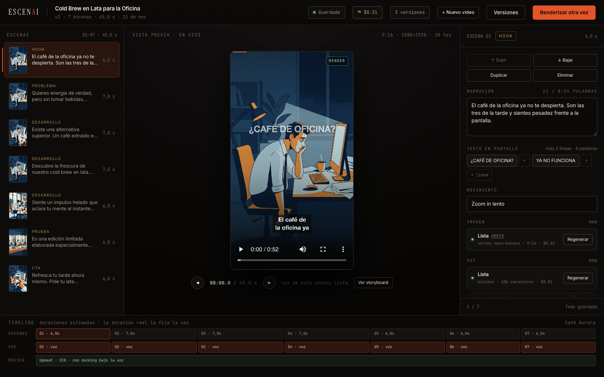
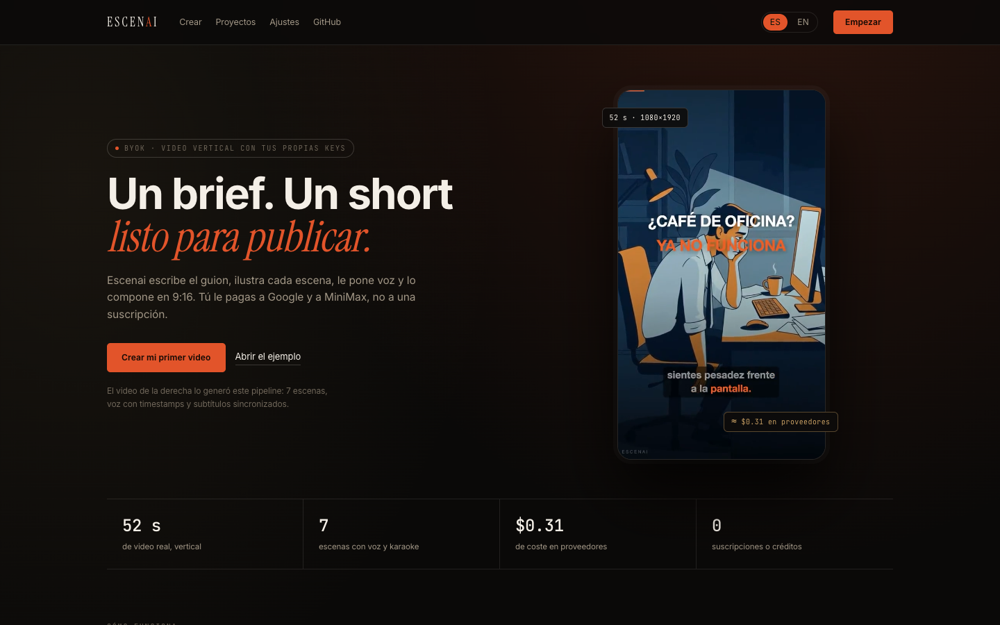

# Escenai

Convierte un brief de marketing en un video vertical con voz, texto animado y subtítulos, usando tus propias API keys. Sin suscripción y sin intermediarios: tú pones la key, tú pagas el consumo.

Escribes cuatro campos, el modelo propone el guion, y desde ahí trabajas en un **estudio**: ves el video 9:16 en vivo, corriges una escena y regeneras solo su imagen, y lanzas el render cuando el coste te cuadra.



---

## El flujo

1. **Brief** en `/new`: qué ofreces, a quién, qué debe sentir y qué debe hacer. Sale un plan validado (escenas, texto en pantalla, narración, prompt de imagen).
2. **Estudio** en `/studio/<id>`: riel de escenas, preview 9:16 real e inspector. Un solo botón, **«Hacer video»**, genera lo que falte (imagen y voz por escena, en serie por la cuota del proveedor) y encadena el render; el trabajo sigue aunque cierres la pestaña.
   - El preview es el **mismo componente** que renderiza el worker, montado con `@remotion/player`: lo que ves es lo que sale.
   - Cada escena tiene su imagen y su voz persistidas; se generan y regeneran por separado.
   - Editas narración, texto en pantalla, movimiento y estilo de subtítulos con el validador del dominio, y los errores aparecen junto al campo culpable.
   - Mueves, duplicas o borras escenas sin romper el contrato (los roles se reasignan por posición).
   - Un **tablero de estilo**: subes la foto del producto, el personaje o el logo una vez y viajan como referencia en todas las escenas, para que la marca no se rediseñe en cada una.
3. **Render**: un trabajo en segundo plano con progreso. Puedes cerrar la pestaña; al volver, el estudio retoma el estado.
4. **MP4** 1080×1920 con voz, karaoke sincronizado, transiciones y sonido.



## Qué cuesta de verdad

Precios de lista al 2026-11-12, en un solo archivo: [`apps/web/src/lib/prices.ts`](apps/web/src/lib/prices.ts).

| Concepto | Precio | En un video de 45 s (7 escenas) |
|---|---|---|
| Imágenes · Vertex Nano Banana 2.1 | $0.0336 / imagen | $0.24 |
| Voz · MiniMax `speech-2.8-hd` | $0.10 / 1.000 caracteres | $0.08 |
| Render | local (Chromium) | $0.00 |
| **Total** | | **≈ $0.31** |

El estudio muestra ese desglose antes de gastar y actualiza el contador con cada cambio del plan. Los clips de video generativo quedan apagados por defecto: 45 s con IA de video cuestan entre $7 y $21, cien veces más que componer.

## Requisitos

- Node 20 o superior (probado con 22 y 25)
- pnpm 12 (lo fija `packageManager` en `package.json`)
- ffmpeg
- Chrome o Chromium (el render los usa)
- Docker, solo para el self-host

Funciona en macOS, Linux y Windows: finales de línea LF forzados y scripts multiplataforma.

## Arrancar en local

```bash
pnpm install

# clave que cifra las API keys (32 bytes en base64)
node -e "console.log('MASTER_KEY=' + require('crypto').randomBytes(32).toString('base64'))" > apps/web/.env.local

pnpm dev
# http://localhost:3000       landing
# http://localhost:3000/new   brief
```

Sin `.env.local` la app arranca, pero Ajustes avisa de que falta `MASTER_KEY` y no deja guardar keys.

## Proveedores

Las keys se pegan en `/settings`. Se guardan cifradas con AES-256-GCM y se verifican contra el proveedor al guardarlas.

| Proveedor | Credencial | Para qué |
|---|---|---|
| Google Vertex | cuenta de servicio (JSON) | guion (`gemini-3.6-flash`) e imágenes (`gemini-nano-banana-2.1`) |
| Google AI Studio | API key `AIza…` | guion por la API pública |
| MiniMax | API key | voz (`speech-2.8-hd`) e imágenes (`image-01`) |

Notas medidas con la cuenta real, no con la documentación:

- **Vertex solo responde en la ubicación `global`**: en `us-central1` devuelve 404 para todos los modelos. Por eso `VERTEX_LOCATION` está en `.env`.
- **Imágenes**: Nano Banana respeta el estilo plano y la paleta; `image-01` deriva a cómic/fotorrealismo y puede inventar marcas reales. Vertex es el motor por defecto.
- **Voz**: MiniMax devuelve los timestamps por trozos (`"ca"`, `"f"`, `"é"`); se agrupan en palabras antes de guardar (`groupWordChunks`), o el karaoke muestra letras sueltas.
- **Música**: tres pistas CC0 incluidas en `apps/web/public/music/` (corporativo, upbeat y piano), con autor y origen en su `LICENSES.md`. CC0 y no «royalty free» porque el repositorio **redistribuye los MP3**: licencias como la de Pixabay prohíben distribuirlos de forma aislada. El volumen baja solo bajo la voz (`duckingGain`).

## Verificar que todo está sano

```bash
pnpm check     # lint + typecheck + tests de los 5 paquetes
pnpm build     # build de producción
```

La frontera de arquitectura se prueba: `packages/core` no puede importar `next`, `react`, SDKs de proveedor ni `node:*`; lo impone ESLint.

## Estructura

```
apps/
  web/            Next.js 15 (App Router) + Tailwind 4 + i18n ES/EN
  worker/         registra la composición y renderiza con Remotion
packages/
  core/           dominio, puertos, casos de uso, prompts y validadores
  adapters/       cifrado, almacenamiento, Vertex, MiniMax
  composition/    la composición de video (la usan worker y web)
infra/            docker-compose para self-host
```

## Desplegar

El render necesita Chromium y minutos de CPU, y los datos viven en disco: no cabe en serverless. Un contenedor con volumen persistente:

```bash
cp .env.example apps/web/.env.local   # MASTER_KEY, DEMO_PASSWORD y modelos
docker compose -f infra/docker-compose.prod.yml up -d --build
curl -s localhost:3000/api/health
```

`DEMO_PASSWORD` es obligatoria si la URL es pública: sin login, cualquiera generaría imágenes con las keys guardadas y consumiría cuota ajena. Con esa variable toda la app pide usuario y contraseña.

Verificado el 2026-11-12 con la imagen actual (**2,16 GB**): contenedor arriba en menos de 10 s, rutas 200 y un render de prueba dentro del contenedor a 1080×1920. La mayor parte del peso es Chromium y sus dependencias, no la aplicación (454 MB).

## Principios

1. **Contrato primero.** El LLM propone un JSON, un validador determinista lo acepta o lo rechaza, el render consume exactamente ese JSON. El modelo nunca calcula tiempos.
2. **La voz manda.** La duración de cada escena la decide el audio real. Un guion de 45 s que narra en 55 s se recorta, no se acelera.
3. **BYOK con cifrado.** Las keys se guardan cifradas en servidor (AES-256-GCM), nunca en localStorage ni en el bundle.
4. **Todo lo caro es un trabajo.** Imagen, voz y render tienen estado en disco; la interfaz nunca se queda esperando bloqueada y sobrevive a un F5.
5. **El preview es el render.** Una sola composición en `packages/composition`; con dos plantillas, el preview mentiría.
6. **El núcleo no sabe quién es MiniMax.** Si mañana entra otro proveedor, se escribe un adaptador y no se toca `packages/core`.

## Estado

Funciona de punta a punta: brief → plan → un botón que genera imágenes y voz, encadena el render y entrega el MP4. Pendiente: edición por máscara para cambiar un fondo sin regenerar la escena (R5) y proveedores alternativos (R8).

## Licencia

MIT (ver `LICENSE`).
